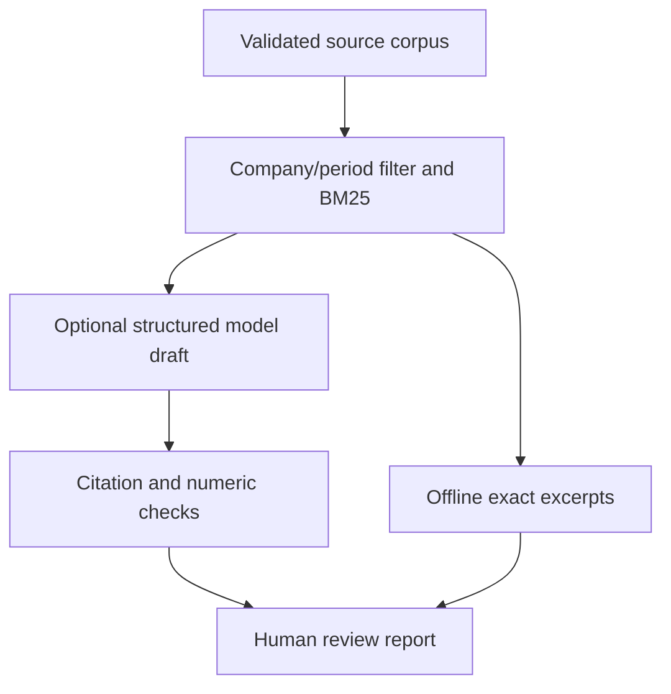

# 07 — Cited Financial Document Assistant

A small, inspectable retrieval-augmented generation (RAG) prototype for financial
document excerpts. It filters by company and financial period, retrieves exact
paragraph spans with lexical BM25, and optionally asks a model for a structured
cited draft. Citation and limited number/currency checks run locally before a
generated draft is displayed. Human review is always required.

**Status:** working offline retrieval/excerpt mode and mocked end-to-end API
tests. An opt-in real API request path is implemented, but **no real-key model
call or production deployment has been verified**. The authored corpus is fictional.

## Run without a key

Python 3.10+, standard library only. From repository root:

```bash
python portfolio/07-cited-financial-assistant/assistant.py
python portfolio/07-cited-financial-assistant/assistant.py --question "ExampleCo FY2025 brüt marjı nedir?" --entity ExampleCo --period FY2025
python portfolio/07-cited-financial-assistant/assistant.py --question "What dividends were paid?"
python portfolio/07-cited-financial-assistant/assistant.py --output /tmp/cited-report.json --markdown /tmp/cited-report.md
```

Offline mode returns **source excerpts**, not a fabricated model answer. The
default revenue question returns the fictional USD 120 million paragraph. The
dividend question returns `insufficient_evidence`. A conflicting FY2024 question
with an FY2025 filter also abstains. Entity and period are explicit filters,
not an automatically inferred financial context.

From this directory:

```bash
python -m unittest discover -v
python evaluate.py --split development
python evaluate.py --split holdout
python evaluate.py --output evaluation-report.json
```

## Optional generated answer

In your own environment, set `OPENAI_API_KEY` and `OPENAI_MODEL` explicitly,
then add `--ai`:

```bash
python portfolio/07-cited-financial-assistant/assistant.py --ai --output /tmp/cited-ai-report.json
```

Use a model your API project can access that supports Responses structured
outputs. This sends the question and retrieved snippets to OpenAI and may
incur charges. Do not commit keys or send data without permission. Missing
keys or API failure leave retrieved excerpts available; they do not create
a fake generated answer. With no evidence, no request is made at all.

Requests use `store: false`, no tools, no redirect following, no automatic
retries, a 30-second timeout, a 30 KB submitted context limit and a 1,200
output-token cap. `store: false` alone does not guarantee all provider retention
behavior. Success records model, response ID, UTC submission time, token usage,
observed request latency, prompt version and submitted-context SHA256. No
pricing table or estimated spend is embedded. Incompatible models may reject
the schema and return `unavailable`.

## Pipeline and contracts



`corpus.json` contains a version, provenance and 1–50 documents. Each document
needs a unique `[A-Za-z0-9_-]+` ID, entity, period, title, provenance and plain
`text`. The file is capped at 1 MB; each text at 50,000 characters. Pass a
custom file via `--corpus /path/to/corpus.json`. No PDF extraction, OCR, HTML
parsing, embeddings, vector database or automatic web fetching is included.

Paragraphs are split on blank lines and capped at 1,000 characters. Every span
has source ID, source-text SHA256, start/end offsets and exact text. Offsets
are zero-based **Python Unicode code-point indexes**, end exclusive, into the
document's `text` field — not bytes, UTF-16 indexes or PDF coordinates. A source
change changes its hash; stored citations must be checked against that version.

Search is case-folded lexical BM25 with k1=1.5 and b=0.75. Stopwords and explicit
entity/period terms are excluded from query coverage; at least 60% of remaining
query terms must appear in a candidate chunk. Return at most three chunks.
Ten fixed Turkish finance aliases are supported, such as `geliri → revenue`
and `brüt marjı → gross margin`; this is not general multilingual semantic search.
The threshold is a heuristic, not a calibrated answerability confidence.

The model schema is in `model.py`: status is `answer` or `insufficient_evidence`,
with claims containing text and citations. Local validation additionally requires:

- At most five claims, each with 1–3 citations from retrieved context only.
- Exact nonempty quotes of at least 12 characters; resolve their source offsets.
- Plain decimal/adjacent-percent tokens and FY years in a claim must occur in
  its cited quotes. Recognized uppercase currency codes USD/EUR/TRY/GBP must match.
- Abstention has an empty claims array. Unknown keys and malformed drafts fail.

Rejected drafts are not displayed. Successful validation is deliberately labeled
`validated_citations_unverified_meaning`: quote presence is not semantic proof.
The checker does not reliably interpret scaled numbers, comma-separated amounts,
arithmetic, other currencies, swapped metric relationships, negation or causality.
For example, “revenue collapsed to USD 120 million” can pass citation checks even
when the source never states a collapse. Tests explicitly preserve this known limit.

## Evaluation and limits

See [evaluation-report.json](evaluation-report.json). Sixteen authored cases are
partitioned before the first evaluation into eight development and eight holdout
cases. Policy was fixed before that run. Development retrieves the expected
span for 5/5 supported cases and abstains on 3/3 unsupported cases. Holdout has
4/4 supported hits and 4/4 abstentions. All returned offsets match source text.

These tiny, authored fixtures are **not independently reviewed** and do not
establish generalization, real-model accuracy or factual grounding. No model
was called for evaluation. After viewing holdout results, future retrieval changes
need a fresh independent test set. Corpus/evaluation hashes make the exact fixture
versions inspectable. Gold labels are never sent to the retrieval or model functions.

Read [ARCHITECTURE.md](ARCHITECTURE.md) for engineering decisions and next steps.
See [sample-report.md](sample-report.md) for the offline answer format.

API references: [Responses](https://developers.openai.com/api/reference/resources/responses/methods/create)
and [Structured Outputs](https://developers.openai.com/api/docs/guides/structured-outputs).
