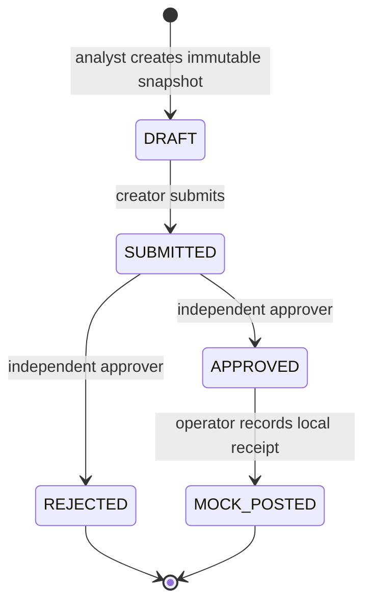

# 08 — Finance Review API

A **working loopback HTTP prototype** for reviewing financial/AI report snapshots.
It demonstrates bearer authentication, role permissions, SQLite persistence,
independent approval, optimistic version checks, transactional idempotency and
an audited mock posting step. It does not call a model, move money or write to
an ERP. The sample imports fictional source evidence from project 07.

Python 3.10+, standard library only; no package installation or external service
needed. This uses Python's HTTP server for a local demonstration, not a production
web framework. It binds only to `127.0.0.1` and does not provide TLS or an identity provider.

## Run the complete demonstration

From repository root:

```bash
python portfolio/08-finance-review-api/demo.py
python portfolio/08-finance-review-api/demo.py --output /tmp/review-api-report.json --markdown /tmp/review-api-report.md
```

The demo starts a real server on an ephemeral loopback port, generates three
temporary credentials, exercises HTTP requests and stores records in temporary
SQLite. It then stops the server and deletes its temporary database. Tokens
are never printed or saved. UUIDs and UTC event timestamps vary per run.

The scenario demonstrates a 401 unauthenticated request, 403 forbidden own-role
approval, 409 stale decision, successful independent approval and one mock receipt.
Replaying an identical create/post returns the original response; a second posting
with a new key is blocked. See [sample-report.md](sample-report.md) and
[sample-report.json](sample-report.json) for a recorded local run.

From this directory run `python -m unittest discover -v`. All 26 tests pass,
including actual HTTP requests, concurrent requests, database reopening and an
injected receipt-write failure to verify transaction rollback. These are software
checks, not evidence of real financial impact or production security certification.

## Workflow



Every transition checks the expected version and records actor, note, UTC time
and new version. There is no report-update endpoint. Corrected evidence requires
a new review; rejected reviews cannot be resubmitted. Creator self-approval is
blocked even if their configured role later changes.

## Persistent manual server

Set `FINANCE_API_USERS_JSON` in your environment to a JSON mapping of actor IDs
to `token` and `role`. Actor IDs use 1–64 letters/digits/underscore/hyphen.
Each token must be a distinct randomly generated URL-safe string of 32–256
characters. Allowed roles: `analyst`, `approver`, `operator`. For example,
generate a local three-role configuration without printing it to the terminal:

```bash
export FINANCE_API_USERS_JSON="$(python -c 'import json,secrets; print(json.dumps({role:{"role":role,"token":secrets.token_urlsafe(32)} for role in ("analyst","approver","operator")}))')"
python portfolio/08-finance-review-api/api.py --db /tmp/finance-reviews.db --port 8080
```

The server remains running until interrupted. Use the same environment securely
for the client in another process; do not commit tokens or configuration files.
The database parent directory must already exist. Unlike `demo.py`, this database
persists. `--port 0` selects an available ephemeral port for local testing.
Missing/invalid configuration fails startup without printing credentials.

For example, with the server running and the same configuration available:

```bash
python portfolio/08-finance-review-api/client.py --actor analyst --method POST --path /v1/reviews --payload portfolio/08-finance-review-api/sample-request.json --key create-local-001
```

The response contains the review ID and version. Subsequent POST bodies contain
`expected_version` and a nonempty `note`. See [API_CONTRACT.md](API_CONTRACT.md).

## Guarantees within the local application

- Actor identity/role comes from the bearer credential, never from request JSON.
- Report snapshots are stored with a canonical SHA256 and are not editable via API.
- Actor/route/idempotency-key scope distinguishes operations. A reused key with
  different data returns 409. Identical replay returns the **original** response,
  which can show an older state; GET the review for its current state.
- SQLite `BEGIN IMMEDIATE` makes transition, audit event, receipt and idempotency
  response one atomic transaction. Failure leaves no partial transition.
- Concurrent decisions at the same version yield one transition and one conflict.
- Each review can have at most one local mock receipt. Idempotency does not
  deduplicate equivalent business reports submitted with different creation keys.

## Scope and limits

All authenticated demo users can read all reviews; there is no tenant isolation.
Credentials are static environment-provisioned bearer tokens with no expiry or
user login. DB owners can modify files; this is not tamper-proof audit storage.
There is no rate limiter, backup/restore system, TLS, multi-host deployment or
production identity management. No source hash proves a document is true; the
API validates a minimal report envelope, not financial correctness or model quality.

This API provides the human-review boundary around projects 04–07. Financial
calculations/retrieval remain in those projects. A model cannot approve a review
unless someone gives it a privileged credential, which this application never does.

See [ARCHITECTURE.md](ARCHITECTURE.md) for design and validation evidence.
Primary references: [Python HTTP server scope](https://docs.python.org/3/library/http.server.html)
and [SQLite transactions](https://www.sqlite.org/lang_transaction.html).
